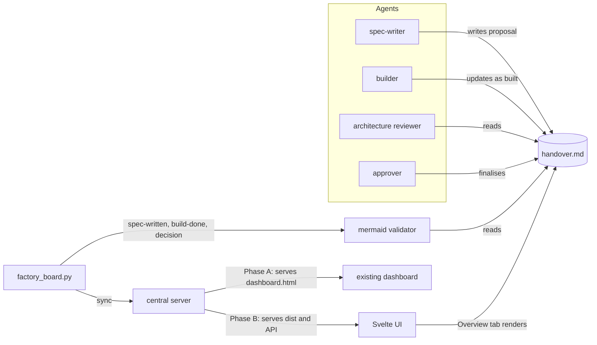
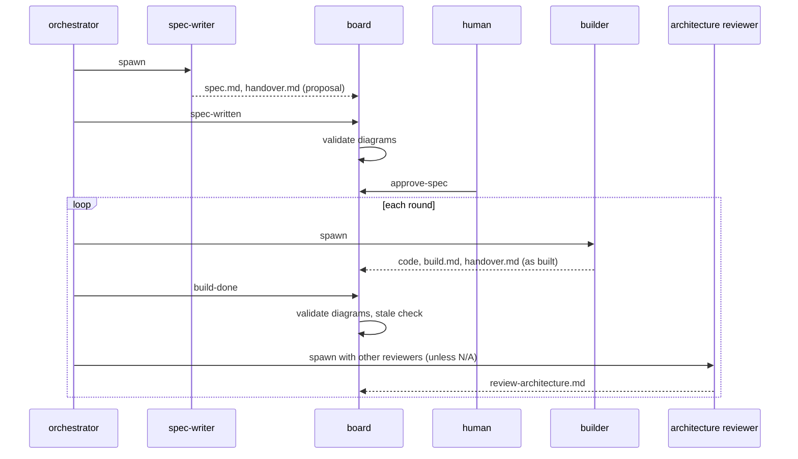

# Factory Visual Handover, Overview UI and Architecture Review

**Status:** Revision 2 Approved 2026-10-30 (Phase A and Phase B)
**Revision:** 2 (2026-10-30)

| Phase | Scope | Approval status |
|---|---|---|
| A | Factory pipeline: `handover.md`, diagram validation, architecture reviewer | Approved 2026-10-30 (Revision 2) |
| B | New Svelte UI with Overview tab and mermaid rendering | Approved 2026-10-30 (Revision 2) |

The developer approved both phases of Revision 2 explicitly ("approve both, start
implementing") on 2026-10-30. Each phase is still implemented and shipped on its own,
Phase A first. Approval applies to this revision; material changes require renewed approval.

Revision 1 (2026-10-30) was one plan with one approval. Revision 2 separates the phases
(D38), records the Svelte tooling choice (D40), and removes a coupling Revision 1 had
introduced: Phase A's validator no longer takes its dependencies from the Phase B UI.

## Objective

Handover text in `.factory/jobs/<id>/` is long and hard to scan. The developer wants:

1. Mermaid architecture, flow and sequence diagrams in the factory markdown, so the
   proposal can be understood visually before spec approval.
2. A redesigned dashboard with an **Overview** tab: executive summary, diagrams,
   changed components, verification results, risks and observations.
3. Mermaid rendering in the UI, syntax validation, and a check that diagrams match
   the implemented code, including a reviewer in the review cycle.
4. Diagrams that are updated as the build iterates.
5. A UI foundation that can later host a Kanban board and notes (out of scope now).

## Phase A: factory pipeline

Ships first and stands alone. The existing dashboard is not replaced: it already shows
`handover.md` as a raw file tab, because it lists every `*.md` in the job.

### Acceptance criteria (proposed)

1. The spec-writer may write `handover.md` containing an executive summary and,
   only where useful, mermaid diagrams. Diagrams are never required.
2. The builder updates `handover.md` each round so it describes what was built,
   and records deviations from the approved proposal. `spec.md` stays frozen.
3. The board validates mermaid blocks in `handover.md` at `spec-written`,
   `build-done` and `decision`. A syntax error is a rule violation the orchestrator
   must fix. If the validator cannot run (no Node or dependencies), the board records
   a warning and continues.
4. A fifth reviewer, `architecture`, compares the spec's proposal and
   `handover.md` diagrams with `change.patch`. It writes `VERDICT: PASS|CHANGES|N/A`.
5. The board writes the architecture review as `N/A` itself when the spec says
   `Architecture impact: no` **and** `handover.md` has no diagrams.
6. `decision.md` is reduced to `ESCALATE`, a one-line recommendation and a pointer
   to `handover.md`.
7. The board warns when code changed in a round but `handover.md` was not updated.
   This is a staleness signal, not a claim that the diagrams are correct.
8. The existing dashboard lists the architecture reviewer alongside the other reviewers.
9. The validator's dependencies are owned by the factory skill itself, not by the UI.

### Implementation steps

1. Add `roles/review-architecture.md`; add `architecture` to `REVIEWERS`, `ROLE_STAGES`,
   stage tiers, the Claude subagent install and the model presets.
2. Add the architecture skip rule next to the UI skip rule; add `Architecture impact` to the
   spec-writer's output.
3. Update `spec-writer.md`, `builder.md`, `approver.md` and `review-code.md` for
   `handover.md`, deviations, and the slimmed `decision.md`.
4. Add the diagram validator under the factory skill with its own small `package.json`
   (pinned mermaid and jsdom) and the board hook at `spec-written`, `build-done` and
   `decision`, including the warning path.
5. Add the staleness warning.
6. Add the architecture reviewer to the existing dashboard's reviewer list.
7. Update `SKILL.md`, `docs/factory.md` and the README. README lines 36 and 140 narrow from
   "no third-party packages" to "one optional validator dependency".

### Verification (expected)

- Board tests: a bad diagram is rejected at each hook; missing Node degrades to a warning;
  the architecture reviewer's header and `N/A` rules; the skip rule; the staleness warning;
  old jobs without `handover.md` still progress.
- Validator tests use real mermaid parsing, not mocks.
- `npm test` and the declared quality gate continue to pass.

## Phase B: new UI

Starts after Phase A is merged. It consumes `handover.md` as plain markdown, so it has no
code dependency on Phase A beyond that file existing.

### Acceptance criteria (proposed)

10. The factory UI is a Svelte application built with Vite (no SvelteKit). It replaces
    `assets/dashboard.html`. Existing capabilities are preserved: pipeline and grouped
    views, repository grouping, job modal with file tabs, archive action, dark mode,
    2-second polling, verdict chips, human-attention highlighting.
11. The job view opens on an **Overview** tab that renders `handover.md`, with mermaid
    diagrams rendered in the browser. A diagram that fails to render shows an error card
    with its source, never a blank gap. Diagrams re-render on theme change. A job with no
    `handover.md` opens on its file tabs instead.
12. The central server serves the built UI. The per-repository static dashboard and its
    `board.json` fallback are removed.
13. The UI is built on install. `npm run dashboard` builds it if `dist/` is missing or older
    than the sources, then starts the server in the foreground.
14. Rendered job markdown cannot execute script, and the static route cannot serve files
    outside `dist/`.

### Implementation steps

1. Scaffold the Svelte and Vite project; add `node_modules/` and `dist/` to `.gitignore`;
   commit `package-lock.json`; `npm run dashboard` builds then serves.
2. Port the existing views and behaviour (criterion 10) with a maintained markdown renderer.
3. Add the Overview tab and mermaid rendering with error cards and theme re-render.
4. Add the static route to the central server; remove `init()`'s dashboard copy and the
   `board.json` data path.
5. Redesign using the `impeccable` skill, with `DESIGN.md` updated to match.
6. Update `PRODUCT.md`, README, `docs/factory.md`, `SKILL.md` and the factory-server command
   for the removed single-file and per-repository constraints.

### Verification (expected)

- Server test: the static route serves `dist/` and refuses traversal outside it.
- UI: component tests for markdown and mermaid rendering (including the failure card and
  script-bearing markdown), and a manual browser check of the Overview tab in light and
  dark themes.
- `npm test` and the declared quality gate continue to pass.

## Repository evidence (observed)

- Dashboard is one file, `assets/dashboard.html` (about 1,700 lines), with a
  hand-written markdown renderer (`dashboard.html:1514-1600`) that renders every
  code fence as escaped text.
- `_collect_job_files` sends every `*.md` in a job directory to the central server
  (`factory_board.py:137`), so a new `handover.md` reaches the UI with no transport change.
- The central server serves only `/` and `/api/*` (`central_factory_server.py:81-96`).
- `init()` copies only `dashboard.html` into `.factory/` (`factory_board.py:252`).
- Reviewers are hard-coded: `REVIEWERS = ("security","ux","ui","code")`
  (`factory_board.py:33`), with a mirrored list in `dashboard.html`. The UI-review skip rule
  at `factory_board.py:618-626` is the precedent for the architecture skip rule.
- The builder may write only `build.md` under `.factory/` (`roles/builder.md:25`).
- The quality gate works on `git diff <base>` and is standard-library only
  (`quality_gate.py:1-8`). `.factory/` is git-excluded, so the gate never sees job-level
  diagrams.
- `PRODUCT.md` and `decisions/central-factory-dashboard.md` state "single HTML file, no
  build step, no dependencies". README lines 36 and 140 state no third-party packages
  are required. These statements become false under this plan.
- `.gitignore` ignores only Python caches.

### Experiments (executed, in a temp directory outside the repository)

| Experiment | Result |
|---|---|
| `mermaid.parse()` under jsdom on Node 22 (`mermaid@11.17.2`, `jsdom@29.1.1`) | Catches syntax errors for flowchart, sequence, class, ER, state, journey, gantt |
| `mermaid.render()` under jsdom | Fails (`CSSStyleSheet is not defined`): rendering needs a browser |
| Mermaid UMD bundle injected as a `<script>` element in jsdom | Loads, `parse()` works |
| Mermaid UMD bundle through `window.eval` in jsdom | Fails to load |
| Hand-written minimal DOM shim, no jsdom | Fails to load |
| Mermaid ESM build | 206 chunk files (16 MB) |

Not established: whether `parse()` accepts diagrams that then fail to render, and how
stable the jsdom approach is across mermaid versions.

Corrections found during Phase A implementation (2026-10-30):

- The full validator install is about 180 MB (`mermaid` alone is 84 MB, plus its transitive
  dependencies), not the 83 MB the experiments suggested. It stays optional and git-ignored.
- `jsdom@29.1.1` requires Node.js 20.19+, 22.13+ or 24+, which is stricter than the README's
  earlier "Node.js 18 or newer". An unsupported Node degrades to a warning like a missing
  install.
- The validator guard that decides whether `check_mermaid.mjs` was run directly compared
  `import.meta.url` with `argv[1]` as strings. On macOS paths under `/var` are symlinks to
  `/private/var`, so the comparison failed and the script silently exited 0 with no output.
  It now compares real paths and treats an unresolvable `argv[1]` as "imported".
- A job that was already in the `review` stage when the architecture reviewer shipped would
  have waited forever for a file nobody was asked to write. `read_reviews` now writes an
  `N/A` file for that case, which a repeated `round-status` also reads correctly. The experiments used the npm package
entry; the Phase A validator should load mermaid from its own pinned package, which this
revision's validator design assumes but was not separately tested.

## Implementation notes (2026-10-30)

Both phases are implemented. Facts learned along the way, and deviations from the approved plan:

- **Mermaid version pinned to match.** The UI and the validator both pin `mermaid@11.17.2`.
  Latest was 12.2.0; a diagram could pass validation on one grammar and fail to render on
  the other, so they must move together.
- **Diagram source is base64-encoded in the rendered HTML.** DOMPurify removes any attribute
  whose value contains `-->`, which every flowchart edge does, so raw source was stripped.
  Base64 survives sanitising and means the source is never parsed as markup in between.
- **Static serving is an allowlist, not `SimpleHTTPRequestHandler`.** The server's handler
  class can serve any file under the working directory; the static route resolves the real
  path and requires it to sit inside `ui/dist`, which defeats `..`, encoded `..` and symlinks.
  A missing `index.html` returns 503 with the build command; other misses return 404.
- **`npm run dashboard` is a Node launcher** (`scripts/dashboard.mjs`) with the staleness
  decision in `scripts/ui-build-state.mjs` so it can be tested without starting a server.
- **Old UI removed.** `assets/dashboard.html`, its copy in `init()` and the
  `python3 -m http.server` instructions are gone (D31). `DASHBOARD_COMMAND` is now
  `npm run dashboard`.
- **Pipeline layout.** The ported CSS hard-coded nine columns; the board has ten stages, so
  `Needs Human` was clipped off screen. The grid now flows in one row and scrolls inside
  itself. Found by looking at a screenshot, not by the automated checks.
- **Favicon.** The app ships `favicon.svg`; without it every page load logged a 404.
- **Modal kept.** Jobs still open in a dialog (the approved behaviour). A full-page job view
  would suit long handovers better and is a design change left for a later decision.
- **Superseded constraints.** "Single HTML file, no build step, no dependencies" in
  `PRODUCT.md` and `decisions/central-factory-dashboard.md`, and the per-repository
  dashboard in `decisions/engineering-guard-factory.md`, no longer hold. `PRODUCT.md`,
  `DESIGN.md`, README, `docs/factory.md`, `SKILL.md`, the factory-server command and the demo
  scenario were updated; the older records are left as the history of what was decided then.

## Developer decisions

| # | Decision | Date |
|---|---|---|
| D29 | The factory UI moves off the single HTML file to a built frontend application. Dependencies in the UI are accepted. | 2026-10-30 |
| D30 | The UI framework is **Svelte**, chosen for being lightweight. | 2026-10-30 |
| D31 | The per-repository static dashboard and `board.json` fallback are dropped. The central server is the only mode, run from the terminal with `npm run dashboard`. | 2026-10-30 |
| D32 | The UI is built on install, not committed. | 2026-10-30 |
| D33 | Diagrams and the executive summary live in a new per-job `handover.md`. The developer has no strong preference and accepts the agent's recommendation. | 2026-10-30 |
| D34 | `decision.md` becomes a pointer: `ESCALATE`, one-line recommendation, link to the handover. | 2026-10-30 |
| D35 | A standalone `architecture` reviewer is added to the review cycle. It is skippable for small changes. | 2026-10-30 |
| D36 | Skip rule: `N/A` when the spec says `Architecture impact: no` and `handover.md` contains no diagrams. | 2026-10-30 |
| D37 | Diagrams are added only when necessary. The board validates those present and never requires any. | 2026-10-30 |
| D38 | Phase A and Phase B are separate: each has its own acceptance criteria, approval and merge. Phase A ships first. (Revision 2; replaces Revision 1's single approval.) | 2026-10-30 |
| D39 | Kanban board and notes are out of scope. The UI structure should not preclude them. | 2026-10-30 |
| D40 | Svelte tooling: the developer delegated the choice ("whatever is best for the project"). Selected: **Svelte with Vite, no SvelteKit.** This is an agent-reasoned choice under that delegation, not an independent developer preference. | 2026-10-30 |

## Architecture (proposed, agent recommendation)

### Components

- **`handover.md`** (per job, living). Executive summary, diagrams where useful, changed
  components, acceptance-criteria evidence, verification, risks, observations, and a
  "Deviations from the approved proposal" section.
- **Diagram validator (Phase A).** A Node script under the factory skill that loads a pinned
  mermaid package into jsdom and calls `parse()`. Called by the board through a subprocess.
  The skill's own `package.json` pins the dependencies. If Node or modules are missing, it
  returns a warning, not an error.
- **`architecture` reviewer (Phase A).** New role `roles/review-architecture.md`, expensive
  tier. Checklist limited to: the spec's proposed architecture against `handover.md`, the
  diagrams against `change.patch`, and unlisted deviations. The code reviewer does not check
  diagrams.
- **Board changes (Phase A).** Fifth reviewer in `REVIEWERS`; skip rule beside the UI skip
  rule; validator hook; staleness warning.
- **UI (Phase B).** Svelte plus Vite project. Mermaid is an npm dependency of the UI. The
  markdown renderer is replaced by a maintained library. The central server serves `dist/`
  with a static-file route; `init()` stops copying the dashboard.

## Alternatives considered

| Option | Status | Evidence and rationale | What would reopen it |
|---|---|---|---|
| Keep the single HTML file, vendor mermaid (3.5 MB) | Rejected by developer | Workable, but the developer wants a UI that will gain Kanban and notes; a hand-written renderer and string templates do not scale to that | Kanban/notes plans dropped |
| Load mermaid from a CDN | Rejected | Breaks offline; third-party script in a page showing agent-written content | None expected |
| Pre-render diagrams to SVG with mermaid-cli | Deferred | Needs Chromium; adds a render step per edit | `parse()` proves to pass diagrams that fail to render |
| Astro | Rejected | Optimised for content sites; this UI is a polling, stateful app, so nearly everything would be islands. Developer did not choose it. | Notes become content-heavy, docs-style pages |
| React | Rejected by developer | Larger Kanban ecosystem, but heavier; developer chose Svelte | Svelte Kanban options prove inadequate |
| Vue | Not chosen | No decisive advantage for this scale | None specific |
| SvelteKit | Rejected (agent reasoning under D40) | The UI is static files served by a Python backend, so SvelteKit's server runtime is unused; it would need `adapter-static` and its filesystem routing adds nothing for a single page with tabs. Not verified against the developer's other Svelte project. | Notes need multiple routed pages or server-side rendering; the developer's existing Svelte project standardises on SvelteKit |
| Single combined A+B approval and merge | Rejected by developer | Revision 1 proposed it; the developer chose separation so a stalled UI rewrite cannot hold up pipeline work | None |
| Validator dependencies taken from the UI project | Rejected (Revision 2) | Would make Phase A depend on a Phase B artifact | None |
| Diagrams only in `spec.md` / `decision.md` | Rejected | `spec.md` is frozen after approval, so diagrams cannot track iterations | None |
| Separate `architecture.md` plus composed Overview | Deferred | Second file and client-side composition for little gain | `handover.md` grows unwieldy |
| Overview extracted client-side from existing files | Rejected | Regex over free prose is brittle and does not reduce text | None |
| Heuristic Python mermaid checker | Rejected | Partial grammar, false confidence | None |
| Validate only in the browser | Kept as a second net (Phase B) | Shows failures but cannot block a bad diagram | N/A |
| Diagram validation in the quality gate | Rejected | The gate reads `git diff`; `.factory/` is git-excluded | None |
| Fold diagram checks into the code reviewer only | Rejected by developer | Developer chose a standalone reviewer | Cost of a fifth reviewer proves too high |
| Committing `dist/` | Rejected by developer | Build on install chosen instead | Install-time builds prove unreliable |
| Keep per-repository fallback | Rejected by developer | Terminal-run central server replaces it | None |

## Constraints and trade-offs

| Aspect | Constraint | Mitigation |
|---|---|---|
| Superseded constraints | "Single HTML file, no dependencies" (`PRODUCT.md`, central dashboard record) and README "no third-party packages" | Phase A narrows the README claim for the validator; Phase B updates `PRODUCT.md`, README, `docs/factory.md`, `SKILL.md` and the factory-server command |
| Dirty-worktree rule | `node_modules/` and `dist/` would break the clean-worktree check and flood `change.patch` | Add both to `.gitignore` (Phase A for the validator's `node_modules/`, Phase B for `dist/`); commit lockfiles |
| Install step (Phase B) | The factory previously needed no install; a stale or missing build means a blank UI | `npm run dashboard` builds when `dist/` is missing or older than the sources; clear error when Node is absent |
| Validator availability (Phase A) | Node and jsdom may be missing in the target repo | Warn and continue, never block |
| Reviewer cost | A fifth expensive-tier reviewer per round | Skip rule (D36) |
| Drift detection | No tool proves diagrams match code | Staleness signal plus reviewer judgement; labelled as such |
| Trust boundary (Phase B) | The server binds `127.0.0.1`; job content is agent-written | The renderer must not execute job markup; mermaid runs with its strict security level; the static route must not allow path traversal |
| Per-repository mode removed (Phase B) | Users lose the no-server option | Accepted by developer (D31) |
| Backwards compatibility | Existing jobs have no `handover.md`; the central store has no architecture review field on old jobs | The UI falls back to the file tabs; the board treats a missing architecture review on old jobs as N/A |
| Phase ordering | Phase B's Overview needs `handover.md` to exist on new jobs | Phase A ships first; Phase B tolerates its absence |

## Open questions and risks

Open, non-blocking:

1. **Markdown library (Phase B).** To be chosen at implementation, with safe HTML handling
   as the requirement.
2. **Existing-job migration.** Jobs already in the central store are left as they are.
3. **Mermaid loaded from its own package in the validator.** The experiments used the npm
   package entry in a temp directory; the Phase A implementation must confirm it works from
   the skill's pinned `package.json`.

Risks:

- The jsdom validation approach is verified on one mermaid version and may need pinning.
- `parse()` may accept diagrams that fail to render; the UI's error card is the backstop
  (Phase B), so until Phase B ships a diagram could pass validation and still fail to render
  in the old dashboard, which does not render mermaid at all.
- Building the factory's own UI through the factory puts the UI project inside the
  repository under change; mitigated by the `.gitignore` entries.
- Phase B is the largest workstream. Phase A is useful on its own because `handover.md` is
  plain markdown the existing dashboard shows as a raw tab.
- The D40 tooling choice rests on agent reasoning, not on a check of the developer's other
  Svelte project's setup.
